# Darwin Engine Report
_2026-10-18T08:01:28.105942+00:00 — evolutionary skill ecosystem_

**Population:** 1179 Skills | **Offspring:** 5 | **Competitions:** 32

## Top 10 (fittest skills)

| Skill | Fitness | Usage | Age (days) | Mutationen W/L |
|---|---|---|---|---|
| autonomous-learning-architecture | 1937.0 | 984 | 0 | 515/93 |
| asi-capability-summary | 1760.23 | 1748 | 23 | 0/0 |
| a2a-brain-meshlearn-verify | 1718.8 | 1706 | 6 | 0/0 |
| darwin-cron-guard | 1353.0 | 284 | 0 | 540/24 |
| darwin-harvested-training-internet-learn-log-jsonl | 1338.0 | 276 | 0 | 535/21 |
| auto-env-checker | 882.23 | 928 | 23 | 15/88 |
| cdp-social-posting | 732.87 | 717 | 4 | 0/0 |
| learning-loop | 664.1 | 653 | 57 | 0/0 |
| train-from-usage | 483.1 | 474 | 27 | 0/4 |
| plugin-api | 355.1 | 344 | 57 | 0/0 |

## Bottom 5 (selection candidates)

- **tao-setup-nvidia-gpu-host** (Fitness 7.77, 7 days old)
- **tao-train-optical-inspection** (Fitness 7.77, 7 days old)
- **web-artifacts-builder** (Fitness 7.77, 7 days old)
- **xlsx** (Fitness 7.77, 7 days old)
- **cron-autotest-run-cron-entry** (Fitness 7.1, 27 days old)

## New mutations

- autonomous-learning-architecture → `autonomous-learning-architecture__mutbroaden_trigger` (op=broaden_trigger, applied=True)
- asi-capability-summary → `asi-capability-summary__mutbroaden_trigger` (op=broaden_trigger, applied=True)
- a2a-brain-meshlearn-verify → `a2a-brain-meshlearn-verify__muttighten_trigger` (op=tighten_trigger, applied=True)
- darwin-cron-guard → `darwin-cron-guard__mutbroaden_trigger` (op=broaden_trigger, applied=True)
- darwin-harvested-training-internet-learn-log-jsonl → `darwin-harvested-training-internet-learn-log-jsonl__muttighten_trigger` (op=tighten_trigger, applied=True)

## Competitions

- ⏳ `a2a-brain-meshlearn-verify+asi-capability-summary` (0) vs `None` (0)
- ⏳ `a2a-brain-meshlearn-verify__mutbroaden_trigger` (1718.8) vs `a2a-brain-meshlearn-verify` (1718.8)
- ⏳ `a2a-brain-meshlearn-verify__muttighten_trigger` (1718.8) vs `a2a-brain-meshlearn-verify` (1718.8)
- ⏳ `asi-capability-summary+asi-identity` (0) vs `None` (0)
- ⏳ `asi-capability-summary__mutbroaden_trigger` (1760.23) vs `asi-capability-summary` (1760.23)
- ⏳ `asi-capability-summary__muttighten_trigger` (1760.23) vs `asi-capability-summary` (1760.23)
- ⏳ `asi-identity+auto-env-checker` (0) vs `None` (0)
- ⏳ `auto-env-checker+autonomous-learning-architecture` (0) vs `None` (0)
- ⏳ `auto-env-checker+cdp-social-posting` (0) vs `None` (0)
- ⏳ `auto-env-checker__mutbroaden_trigger` (882.23) vs `auto-env-checker` (882.23)
- ⏳ `auto-env-checker__muttighten_trigger` (882.23) vs `auto-env-checker` (882.23)
- ⏳ `autonomous-learning-architecture__mutbroaden_trigger` (1937.0) vs `autonomous-learning-architecture` (1937.0)
- ⏳ `autonomous-learning-architecture__muttighten_trigger` (1937.0) vs `autonomous-learning-architecture` (1937.0)
- ⏳ `cdp-social-posting__mutbroaden_trigger` (732.87) vs `cdp-social-posting` (732.87)
- ⏳ `cdp-social-posting__muttighten_trigger` (732.87) vs `cdp-social-posting` (732.87)
- ⏳ `darwin-cron-guard__mutbroaden_trigger` (1353.0) vs `darwin-cron-guard` (1353.0)
- ⏳ `darwin-cron-guard__muttighten_trigger` (1353.0) vs `darwin-cron-guard` (1353.0)
- ⏳ `darwin-harvested-training-internet-learn-log-jsonl__muttighten_trigger` (1338.0) vs `darwin-harvested-training-internet-learn-log-jsonl` (1338.0)
- ⏳ `discord-server-management__mutadd_verification_step` (40.97) vs `discord-server-management` (40.97)
- ⏳ `discord-server-management__mutbroaden_trigger` (40.97) vs `discord-server-management` (40.97)
- ⏳ `discord-server-management__muttighten_trigger` (40.97) vs `discord-server-management` (40.97)
- ⏳ `github-readme-summary__mutbroaden_trigger` (28.77) vs `github-readme-summary` (28.77)
- ⏳ `github-readme-summary__muttighten_trigger` (28.77) vs `github-readme-summary` (28.77)
- ⏳ `openamer-plugin-development__muttighten_trigger` (25.8) vs `openamer-plugin-development` (25.8)
- ⏳ `plugin-api__mutbroaden_trigger` (355.1) vs `plugin-api` (355.1)
- ⏳ `plugin-api__muttighten_trigger` (355.1) vs `plugin-api` (355.1)
- ⏳ `train-from-usage__mutadd_pitfall` (483.1) vs `train-from-usage` (483.1)
- ⏳ `train-from-usage__mutadd_verification_step` (483.1) vs `train-from-usage` (483.1)
- ⏳ `train-from-usage__mutbroaden_trigger` (483.1) vs `train-from-usage` (483.1)
- ⏳ `train-from-usage__muttighten_trigger` (483.1) vs `train-from-usage` (483.1)
- ⏳ `undetectable-browsing__muttighten_trigger` (29.17) vs `undetectable-browsing` (29.17)
- ⏳ `vscode-extension-scaffold__mutbroaden_trigger` (26.1) vs `vscode-extension-scaffold` (26.1)

## Evolution Tree

```mermaid
graph TD
    autonomous-learning-architecture["autonomous-learning-architecture"] --> autonomous-learning-architecture__mutbroaden_trigger["autonomous-learning-architecture__mutbroaden_trigger"]
    asi-capability-summary["asi-capability-summary"] --> asi-capability-summary__mutbroaden_trigger["asi-capability-summary__mutbroaden_trigger"]
    a2a-brain-meshlearn-verify["a2a-brain-meshlearn-verify"] --> a2a-brain-meshlearn-verify__muttighten_trigger["a2a-brain-meshlearn-verify__muttighten_trigger"]
    darwin-cron-guard["darwin-cron-guard"] --> darwin-cron-guard__mutbroaden_trigger["darwin-cron-guard__mutbroaden_trigger"]
    darwin-harvested-training-internet-learn-log-jsonl["darwin-harvested-training-internet-learn-log-jsonl"] --> darwin-harvested-training-internet-learn-log-jsonl__muttighten_trigger["darwin-harvested-training-internet-learn-log-jsonl__muttighten_trigger"]
    autonomous-learning-architecture["autonomous-learning-architecture"] --> darwin-harvested-r-n-exit-0["darwin-harvested-r-n-exit-0"]
    autonomous-learning-architecture["autonomous-learning-architecture"] --> darwin-harvested-n-body-bytes-nhead-cannot-open["darwin-harvested-n-body-bytes-nhead-cannot-open"]
    autonomous-learning-architecture["autonomous-learning-architecture"] --> autonomous-learning-loops["autonomous-learning-loops"]
    darwin-cron-guard["darwin-cron-guard"] --> guard["guard"]
    darwin-harvested-training-internet-learn-log-jsonl["darwin-harvested-training-internet-learn-log-jsonl"] --> learn["learn"]
    autonomous-learning-architecture["autonomous-learning-architecture"] --> autonomous-learning-architecture__mutbroaden_trigger["autonomous-learning-architecture__mutbroaden_trigger"]
    asi-capability-summary["asi-capability-summary"] --> asi-capability-summary__mutbroaden_trigger["asi-capability-summary__mutbroaden_trigger"]
    a2a-brain-meshlearn-verify["a2a-brain-meshlearn-verify"] --> a2a-brain-meshlearn-verify__muttighten_trigger["a2a-brain-meshlearn-verify__muttighten_trigger"]
    darwin-cron-guard["darwin-cron-guard"] --> darwin-cron-guard__mutbroaden_trigger["darwin-cron-guard__mutbroaden_trigger"]
    darwin-harvested-training-internet-learn-log-jsonl["darwin-harvested-training-internet-learn-log-jsonl"] --> darwin-harvested-training-internet-learn-log-jsonl__muttighten_trigger["darwin-harvested-training-internet-learn-log-jsonl__muttighten_trigger"]
    autonomous-learning-architecture["autonomous-learning-architecture"] --> darwin-harvested-scripts-build-skills-index-py["darwin-harvested-scripts-build-skills-index-py"]
    autonomous-learning-architecture["autonomous-learning-architecture"] --> darwin-harvested-n-titel-n-title-live-evolution["darwin-harvested-n-titel-n-title-live-evolution"]
    autonomous-learning-architecture["autonomous-learning-architecture"] --> autonomous-learning-loops["autonomous-learning-loops"]
    darwin-cron-guard["darwin-cron-guard"] --> guard["guard"]
    darwin-harvested-training-internet-learn-log-jsonl["darwin-harvested-training-internet-learn-log-jsonl"] --> learn["learn"]
    autonomous-learning-architecture["autonomous-learning-architecture"] --> autonomous-learning-architecture__mutbroaden_trigger["autonomous-learning-architecture__mutbroaden_trigger"]
    asi-capability-summary["asi-capability-summary"] --> asi-capability-summary__mutbroaden_trigger["asi-capability-summary__mutbroaden_trigger"]
    a2a-brain-meshlearn-verify["a2a-brain-meshlearn-verify"] --> a2a-brain-meshlearn-verify__muttighten_trigger["a2a-brain-meshlearn-verify__muttighten_trigger"]
    darwin-cron-guard["darwin-cron-guard"] --> darwin-cron-guard__mutbroaden_trigger["darwin-cron-guard__mutbroaden_trigger"]
    darwin-harvested-training-internet-learn-log-jsonl["darwin-harvested-training-internet-learn-log-jsonl"] --> darwin-harvested-training-internet-learn-log-jsonl__muttighten_trigger["darwin-harvested-training-internet-learn-log-jsonl__muttighten_trigger"]
    autonomous-learning-architecture["autonomous-learning-architecture"] --> darwin-harvested-openamer-agent["darwin-harvested-openamer-agent"]
    autonomous-learning-architecture["autonomous-learning-architecture"] --> darwin-harvested-bin-python["darwin-harvested-bin-python"]
    autonomous-learning-architecture["autonomous-learning-architecture"] --> autonomous-learning-loops["autonomous-learning-loops"]
    darwin-cron-guard["darwin-cron-guard"] --> guard["guard"]
    darwin-harvested-training-internet-learn-log-jsonl["darwin-harvested-training-internet-learn-log-jsonl"] --> learn["learn"]
    autonomous-learning-architecture["autonomous-learning-architecture"] --> autonomous-learning-architecture__mutbroaden_trigger["autonomous-learning-architecture__mutbroaden_trigger"]
    asi-capability-summary["asi-capability-summary"] --> asi-capability-summary__mutbroaden_trigger["asi-capability-summary__mutbroaden_trigger"]
    a2a-brain-meshlearn-verify["a2a-brain-meshlearn-verify"] --> a2a-brain-meshlearn-verify__muttighten_trigger["a2a-brain-meshlearn-verify__muttighten_trigger"]
    darwin-cron-guard["darwin-cron-guard"] --> darwin-cron-guard__mutbroaden_trigger["darwin-cron-guard__mutbroaden_trigger"]
    darwin-harvested-training-internet-learn-log-jsonl["darwin-harvested-training-internet-learn-log-jsonl"] --> darwin-harvested-training-internet-learn-log-jsonl__muttighten_trigger["darwin-harvested-training-internet-learn-log-jsonl__muttighten_trigger"]
    autonomous-learning-architecture["autonomous-learning-architecture"] --> darwin-harvested-scripts-ship-py["darwin-harvested-scripts-ship-py"]
    autonomous-learning-architecture["autonomous-learning-architecture"] --> darwin-harvested-tmp-mesh-art-html-no-such-file-or-di["darwin-harvested-tmp-mesh-art-html-no-such-file-or-di"]
    autonomous-learning-architecture["autonomous-learning-architecture"] --> autonomous-learning-loops["autonomous-learning-loops"]
    darwin-cron-guard["darwin-cron-guard"] --> guard["guard"]
    darwin-harvested-training-internet-learn-log-jsonl["darwin-harvested-training-internet-learn-log-jsonl"] --> learn["learn"]
```

