# Darwin Engine Report
_2026-10-17T15:45:38.323486+00:00 — evolutionary skill ecosystem_

**Population:** 1154 Skills | **Offspring:** 5 | **Competitions:** 32

## Top 10 (fittest skills)

| Skill | Fitness | Usage | Age (days) | Mutationen W/L |
|---|---|---|---|---|
| autonomous-learning-architecture | 2149.0 | 1265 | 0 | 479/90 |
| asi-capability-summary | 2011.23 | 1999 | 23 | 0/0 |
| a2a-brain-meshlearn-verify | 1718.83 | 1706 | 5 | 0/0 |
| darwin-cron-guard | 1286.0 | 289 | 0 | 504/24 |
| darwin-harvested-training-internet-learn-log-jsonl | 1268.0 | 278 | 0 | 499/21 |
| auto-env-checker | 1189.23 | 1235 | 23 | 15/88 |
| cdp-social-posting | 942.87 | 927 | 4 | 0/0 |
| learning-loop | 751.13 | 740 | 56 | 0/0 |
| train-from-usage | 672.13 | 663 | 26 | 0/4 |
| plugin-api | 543.13 | 532 | 56 | 0/0 |

## Bottom 5 (selection candidates)

- **tao-setup-nvidia-gpu-host** (Fitness 7.77, 7 days old)
- **tao-train-optical-inspection** (Fitness 7.77, 7 days old)
- **web-artifacts-builder** (Fitness 7.77, 7 days old)
- **xlsx** (Fitness 7.77, 7 days old)
- **cron-autotest-run-cron-entry** (Fitness 7.1, 27 days old)

## New mutations

- autonomous-learning-architecture → `autonomous-learning-architecture__mutbroaden_trigger` (op=broaden_trigger, applied=True)
- asi-capability-summary → `asi-capability-summary__mutbroaden_trigger` (op=broaden_trigger, applied=True)
- a2a-brain-meshlearn-verify → `a2a-brain-meshlearn-verify__muttighten_trigger` (op=tighten_trigger, applied=True)
- darwin-cron-guard → `darwin-cron-guard__mutbroaden_trigger` (op=broaden_trigger, applied=True)
- darwin-harvested-training-internet-learn-log-jsonl → `darwin-harvested-training-internet-learn-log-jsonl__muttighten_trigger` (op=tighten_trigger, applied=True)

## Competitions

- ⏳ `a2a-brain-meshlearn-verify+asi-capability-summary` (0) vs `None` (0)
- ⏳ `a2a-brain-meshlearn-verify__mutbroaden_trigger` (1718.83) vs `a2a-brain-meshlearn-verify` (1718.83)
- ⏳ `a2a-brain-meshlearn-verify__muttighten_trigger` (1718.83) vs `a2a-brain-meshlearn-verify` (1718.83)
- ⏳ `asi-capability-summary+asi-identity` (0) vs `None` (0)
- ⏳ `asi-capability-summary__mutbroaden_trigger` (2011.23) vs `asi-capability-summary` (2011.23)
- ⏳ `asi-capability-summary__muttighten_trigger` (2011.23) vs `asi-capability-summary` (2011.23)
- ⏳ `asi-identity+auto-env-checker` (0) vs `None` (0)
- ⏳ `auto-env-checker+autonomous-learning-architecture` (0) vs `None` (0)
- ⏳ `auto-env-checker+cdp-social-posting` (0) vs `None` (0)
- ⏳ `auto-env-checker__mutbroaden_trigger` (1189.23) vs `auto-env-checker` (1189.23)
- ⏳ `auto-env-checker__muttighten_trigger` (1189.23) vs `auto-env-checker` (1189.23)
- ⏳ `autonomous-learning-architecture__mutbroaden_trigger` (2149.0) vs `autonomous-learning-architecture` (2149.0)
- ⏳ `autonomous-learning-architecture__muttighten_trigger` (2149.0) vs `autonomous-learning-architecture` (2149.0)
- ⏳ `cdp-social-posting__mutbroaden_trigger` (942.87) vs `cdp-social-posting` (942.87)
- ⏳ `cdp-social-posting__muttighten_trigger` (942.87) vs `cdp-social-posting` (942.87)
- ⏳ `darwin-cron-guard__mutbroaden_trigger` (1286.0) vs `darwin-cron-guard` (1286.0)
- ⏳ `darwin-cron-guard__muttighten_trigger` (1286.0) vs `darwin-cron-guard` (1286.0)
- ⏳ `darwin-harvested-training-internet-learn-log-jsonl__muttighten_trigger` (1268.0) vs `darwin-harvested-training-internet-learn-log-jsonl` (1268.0)
- ⏳ `discord-server-management__mutadd_verification_step` (45.0) vs `discord-server-management` (45.0)
- ⏳ `discord-server-management__mutbroaden_trigger` (45.0) vs `discord-server-management` (45.0)
- ⏳ `discord-server-management__muttighten_trigger` (45.0) vs `discord-server-management` (45.0)
- ⏳ `github-readme-summary__mutbroaden_trigger` (29.8) vs `github-readme-summary` (29.8)
- ⏳ `github-readme-summary__muttighten_trigger` (29.8) vs `github-readme-summary` (29.8)
- ⏳ `openamer-plugin-development__muttighten_trigger` (25.83) vs `openamer-plugin-development` (25.83)
- ⏳ `plugin-api__mutbroaden_trigger` (543.13) vs `plugin-api` (543.13)
- ⏳ `plugin-api__muttighten_trigger` (543.13) vs `plugin-api` (543.13)
- ⏳ `train-from-usage__mutadd_pitfall` (672.13) vs `train-from-usage` (672.13)
- ⏳ `train-from-usage__mutadd_verification_step` (672.13) vs `train-from-usage` (672.13)
- ⏳ `train-from-usage__mutbroaden_trigger` (672.13) vs `train-from-usage` (672.13)
- ⏳ `train-from-usage__muttighten_trigger` (672.13) vs `train-from-usage` (672.13)
- ⏳ `undetectable-browsing__muttighten_trigger` (30.2) vs `undetectable-browsing` (30.2)
- ⏳ `vscode-extension-scaffold__mutbroaden_trigger` (27.13) vs `vscode-extension-scaffold` (27.13)

## Evolution Tree

```mermaid
graph TD
    autonomous-learning-architecture["autonomous-learning-architecture"] --> autonomous-learning-architecture__mutbroaden_trigger["autonomous-learning-architecture__mutbroaden_trigger"]
    asi-capability-summary["asi-capability-summary"] --> asi-capability-summary__mutbroaden_trigger["asi-capability-summary__mutbroaden_trigger"]
    a2a-brain-meshlearn-verify["a2a-brain-meshlearn-verify"] --> a2a-brain-meshlearn-verify__muttighten_trigger["a2a-brain-meshlearn-verify__muttighten_trigger"]
    darwin-cron-guard["darwin-cron-guard"] --> darwin-cron-guard__mutbroaden_trigger["darwin-cron-guard__mutbroaden_trigger"]
    darwin-harvested-training-internet-learn-log-jsonl["darwin-harvested-training-internet-learn-log-jsonl"] --> darwin-harvested-training-internet-learn-log-jsonl__muttighten_trigger["darwin-harvested-training-internet-learn-log-jsonl__muttighten_trigger"]
    autonomous-learning-architecture["autonomous-learning-architecture"] --> autonomous-learning-loops["autonomous-learning-loops"]
    darwin-cron-guard["darwin-cron-guard"] --> guard["guard"]
    darwin-harvested-training-internet-learn-log-jsonl["darwin-harvested-training-internet-learn-log-jsonl"] --> learn["learn"]
    autonomous-learning-architecture["autonomous-learning-architecture"] --> autonomous-learning-architecture__mutbroaden_trigger["autonomous-learning-architecture__mutbroaden_trigger"]
    asi-capability-summary["asi-capability-summary"] --> asi-capability-summary__mutbroaden_trigger["asi-capability-summary__mutbroaden_trigger"]
    a2a-brain-meshlearn-verify["a2a-brain-meshlearn-verify"] --> a2a-brain-meshlearn-verify__muttighten_trigger["a2a-brain-meshlearn-verify__muttighten_trigger"]
    darwin-cron-guard["darwin-cron-guard"] --> darwin-cron-guard__mutbroaden_trigger["darwin-cron-guard__mutbroaden_trigger"]
    darwin-harvested-training-internet-learn-log-jsonl["darwin-harvested-training-internet-learn-log-jsonl"] --> darwin-harvested-training-internet-learn-log-jsonl__muttighten_trigger["darwin-harvested-training-internet-learn-log-jsonl__muttighten_trigger"]
    autonomous-learning-architecture["autonomous-learning-architecture"] --> autonomous-learning-loops["autonomous-learning-loops"]
    darwin-cron-guard["darwin-cron-guard"] --> guard["guard"]
    darwin-harvested-training-internet-learn-log-jsonl["darwin-harvested-training-internet-learn-log-jsonl"] --> learn["learn"]
    autonomous-learning-architecture["autonomous-learning-architecture"] --> autonomous-learning-architecture__mutbroaden_trigger["autonomous-learning-architecture__mutbroaden_trigger"]
    asi-capability-summary["asi-capability-summary"] --> asi-capability-summary__mutbroaden_trigger["asi-capability-summary__mutbroaden_trigger"]
    a2a-brain-meshlearn-verify["a2a-brain-meshlearn-verify"] --> a2a-brain-meshlearn-verify__muttighten_trigger["a2a-brain-meshlearn-verify__muttighten_trigger"]
    darwin-cron-guard["darwin-cron-guard"] --> darwin-cron-guard__mutbroaden_trigger["darwin-cron-guard__mutbroaden_trigger"]
    darwin-harvested-training-internet-learn-log-jsonl["darwin-harvested-training-internet-learn-log-jsonl"] --> darwin-harvested-training-internet-learn-log-jsonl__muttighten_trigger["darwin-harvested-training-internet-learn-log-jsonl__muttighten_trigger"]
    autonomous-learning-architecture["autonomous-learning-architecture"] --> autonomous-learning-loops["autonomous-learning-loops"]
    darwin-cron-guard["darwin-cron-guard"] --> guard["guard"]
    darwin-harvested-training-internet-learn-log-jsonl["darwin-harvested-training-internet-learn-log-jsonl"] --> learn["learn"]
    autonomous-learning-architecture["autonomous-learning-architecture"] --> autonomous-learning-architecture__mutbroaden_trigger["autonomous-learning-architecture__mutbroaden_trigger"]
    asi-capability-summary["asi-capability-summary"] --> asi-capability-summary__mutbroaden_trigger["asi-capability-summary__mutbroaden_trigger"]
    a2a-brain-meshlearn-verify["a2a-brain-meshlearn-verify"] --> a2a-brain-meshlearn-verify__muttighten_trigger["a2a-brain-meshlearn-verify__muttighten_trigger"]
    darwin-cron-guard["darwin-cron-guard"] --> darwin-cron-guard__mutbroaden_trigger["darwin-cron-guard__mutbroaden_trigger"]
    darwin-harvested-training-internet-learn-log-jsonl["darwin-harvested-training-internet-learn-log-jsonl"] --> darwin-harvested-training-internet-learn-log-jsonl__muttighten_trigger["darwin-harvested-training-internet-learn-log-jsonl__muttighten_trigger"]
    autonomous-learning-architecture["autonomous-learning-architecture"] --> autonomous-learning-loops["autonomous-learning-loops"]
    darwin-cron-guard["darwin-cron-guard"] --> guard["guard"]
    darwin-harvested-training-internet-learn-log-jsonl["darwin-harvested-training-internet-learn-log-jsonl"] --> learn["learn"]
    autonomous-learning-architecture["autonomous-learning-architecture"] --> autonomous-learning-architecture__mutbroaden_trigger["autonomous-learning-architecture__mutbroaden_trigger"]
    asi-capability-summary["asi-capability-summary"] --> asi-capability-summary__mutbroaden_trigger["asi-capability-summary__mutbroaden_trigger"]
    a2a-brain-meshlearn-verify["a2a-brain-meshlearn-verify"] --> a2a-brain-meshlearn-verify__muttighten_trigger["a2a-brain-meshlearn-verify__muttighten_trigger"]
    darwin-cron-guard["darwin-cron-guard"] --> darwin-cron-guard__mutbroaden_trigger["darwin-cron-guard__mutbroaden_trigger"]
    darwin-harvested-training-internet-learn-log-jsonl["darwin-harvested-training-internet-learn-log-jsonl"] --> darwin-harvested-training-internet-learn-log-jsonl__muttighten_trigger["darwin-harvested-training-internet-learn-log-jsonl__muttighten_trigger"]
    autonomous-learning-architecture["autonomous-learning-architecture"] --> autonomous-learning-loops["autonomous-learning-loops"]
    darwin-cron-guard["darwin-cron-guard"] --> guard["guard"]
    darwin-harvested-training-internet-learn-log-jsonl["darwin-harvested-training-internet-learn-log-jsonl"] --> learn["learn"]
```

