# Darwin Engine Report
_2026-10-21T02:41:03.133418+00:00 — evolutionary skill ecosystem_

**Population:** 1185 Skills | **Offspring:** 5 | **Competitions:** 32

## Top 10 (fittest skills)

| Skill | Fitness | Usage | Age (days) | Mutationen W/L |
|---|---|---|---|---|
| autonomous-learning-architecture | 2178.0 | 984 | 0 | 670/162 |
| asi-capability-summary | 1760.13 | 1748 | 26 | 0/0 |
| a2a-brain-meshlearn-verify | 1718.73 | 1706 | 8 | 0/0 |
| darwin-cron-guard | 1667.0 | 284 | 0 | 697/24 |
| darwin-harvested-training-internet-learn-log-jsonl | 1646.0 | 276 | 0 | 689/21 |
| auto-env-checker | 882.13 | 928 | 26 | 15/88 |
| cdp-social-posting | 732.77 | 717 | 7 | 0/0 |
| learning-loop | 672.0 | 661 | 60 | 0/0 |
| train-from-usage | 483.0 | 474 | 30 | 0/4 |
| plugin-api | 355.0 | 344 | 60 | 0/0 |

## Bottom 5 (selection candidates)

- **tao-setup-nvidia-gpu-host** (Fitness 7.67, 10 days old)
- **tao-train-optical-inspection** (Fitness 7.67, 10 days old)
- **web-artifacts-builder** (Fitness 7.67, 10 days old)
- **xlsx** (Fitness 7.67, 10 days old)
- **cron-autotest-run-cron-entry** (Fitness 7.0, 30 days old)

## New mutations

- autonomous-learning-architecture → `autonomous-learning-architecture__mutbroaden_trigger` (op=broaden_trigger, applied=True)
- asi-capability-summary → `asi-capability-summary__mutbroaden_trigger` (op=broaden_trigger, applied=True)
- a2a-brain-meshlearn-verify → `a2a-brain-meshlearn-verify__muttighten_trigger` (op=tighten_trigger, applied=True)
- darwin-cron-guard → `darwin-cron-guard__mutbroaden_trigger` (op=broaden_trigger, applied=True)
- darwin-harvested-training-internet-learn-log-jsonl → `darwin-harvested-training-internet-learn-log-jsonl__muttighten_trigger` (op=tighten_trigger, applied=True)

## Competitions

- ⏳ `a2a-brain-meshlearn-verify+asi-capability-summary` (0) vs `None` (0)
- ⏳ `a2a-brain-meshlearn-verify__mutbroaden_trigger` (1718.73) vs `a2a-brain-meshlearn-verify` (1718.73)
- ⏳ `a2a-brain-meshlearn-verify__muttighten_trigger` (1718.73) vs `a2a-brain-meshlearn-verify` (1718.73)
- ⏳ `asi-capability-summary+asi-identity` (0) vs `None` (0)
- ⏳ `asi-capability-summary__mutbroaden_trigger` (1760.13) vs `asi-capability-summary` (1760.13)
- ⏳ `asi-capability-summary__muttighten_trigger` (1760.13) vs `asi-capability-summary` (1760.13)
- ⏳ `asi-identity+auto-env-checker` (0) vs `None` (0)
- ⏳ `auto-env-checker+autonomous-learning-architecture` (0) vs `None` (0)
- ⏳ `auto-env-checker+cdp-social-posting` (0) vs `None` (0)
- ⏳ `auto-env-checker__mutbroaden_trigger` (882.13) vs `auto-env-checker` (882.13)
- ⏳ `auto-env-checker__muttighten_trigger` (882.13) vs `auto-env-checker` (882.13)
- ⏳ `autonomous-learning-architecture__mutbroaden_trigger` (2178.0) vs `autonomous-learning-architecture` (2178.0)
- ⏳ `autonomous-learning-architecture__muttighten_trigger` (2178.0) vs `autonomous-learning-architecture` (2178.0)
- ⏳ `cdp-social-posting__mutbroaden_trigger` (732.77) vs `cdp-social-posting` (732.77)
- ⏳ `cdp-social-posting__muttighten_trigger` (732.77) vs `cdp-social-posting` (732.77)
- ⏳ `darwin-cron-guard__mutbroaden_trigger` (1667.0) vs `darwin-cron-guard` (1667.0)
- ⏳ `darwin-cron-guard__muttighten_trigger` (1667.0) vs `darwin-cron-guard` (1667.0)
- ⏳ `darwin-harvested-training-internet-learn-log-jsonl__muttighten_trigger` (1646.0) vs `darwin-harvested-training-internet-learn-log-jsonl` (1646.0)
- ⏳ `discord-server-management__mutadd_verification_step` (40.87) vs `discord-server-management` (40.87)
- ⏳ `discord-server-management__mutbroaden_trigger` (40.87) vs `discord-server-management` (40.87)
- ⏳ `discord-server-management__muttighten_trigger` (40.87) vs `discord-server-management` (40.87)
- ⏳ `github-readme-summary__mutbroaden_trigger` (28.67) vs `github-readme-summary` (28.67)
- ⏳ `github-readme-summary__muttighten_trigger` (28.67) vs `github-readme-summary` (28.67)
- ⏳ `openamer-plugin-development__muttighten_trigger` (25.7) vs `openamer-plugin-development` (25.7)
- ⏳ `plugin-api__mutbroaden_trigger` (355.0) vs `plugin-api` (355.0)
- ⏳ `plugin-api__muttighten_trigger` (355.0) vs `plugin-api` (355.0)
- ⏳ `train-from-usage__mutadd_pitfall` (483.0) vs `train-from-usage` (483.0)
- ⏳ `train-from-usage__mutadd_verification_step` (483.0) vs `train-from-usage` (483.0)
- ⏳ `train-from-usage__mutbroaden_trigger` (483.0) vs `train-from-usage` (483.0)
- ⏳ `train-from-usage__muttighten_trigger` (483.0) vs `train-from-usage` (483.0)
- ⏳ `undetectable-browsing__muttighten_trigger` (29.07) vs `undetectable-browsing` (29.07)
- ⏳ `vscode-extension-scaffold__mutbroaden_trigger` (26.0) vs `vscode-extension-scaffold` (26.0)

## Evolution Tree

```mermaid
graph TD
    autonomous-learning-architecture["autonomous-learning-architecture"] --> autonomous-learning-architecture__mutbroaden_trigger["autonomous-learning-architecture__mutbroaden_trigger"]
    asi-capability-summary["asi-capability-summary"] --> asi-capability-summary__mutbroaden_trigger["asi-capability-summary__mutbroaden_trigger"]
    a2a-brain-meshlearn-verify["a2a-brain-meshlearn-verify"] --> a2a-brain-meshlearn-verify__muttighten_trigger["a2a-brain-meshlearn-verify__muttighten_trigger"]
    darwin-cron-guard["darwin-cron-guard"] --> darwin-cron-guard__mutbroaden_trigger["darwin-cron-guard__mutbroaden_trigger"]
    darwin-harvested-training-internet-learn-log-jsonl["darwin-harvested-training-internet-learn-log-jsonl"] --> darwin-harvested-training-internet-learn-log-jsonl__muttighten_trigger["darwin-harvested-training-internet-learn-log-jsonl__muttighten_trigger"]
    autonomous-learning-architecture["autonomous-learning-architecture"] --> autonomous-learning-loops["autonomous-learning-loops"]
    darwin-cron-guard["darwin-cron-guard"] --> guard["guard"]
    darwin-harvested-training-internet-learn-log-jsonl["darwin-harvested-training-internet-learn-log-jsonl"] --> learn["learn"]
    autonomous-learning-architecture["autonomous-learning-architecture"] --> autonomous-learning-architecture__mutbroaden_trigger["autonomous-learning-architecture__mutbroaden_trigger"]
    asi-capability-summary["asi-capability-summary"] --> asi-capability-summary__mutbroaden_trigger["asi-capability-summary__mutbroaden_trigger"]
    a2a-brain-meshlearn-verify["a2a-brain-meshlearn-verify"] --> a2a-brain-meshlearn-verify__muttighten_trigger["a2a-brain-meshlearn-verify__muttighten_trigger"]
    darwin-cron-guard["darwin-cron-guard"] --> darwin-cron-guard__mutbroaden_trigger["darwin-cron-guard__mutbroaden_trigger"]
    darwin-harvested-training-internet-learn-log-jsonl["darwin-harvested-training-internet-learn-log-jsonl"] --> darwin-harvested-training-internet-learn-log-jsonl__muttighten_trigger["darwin-harvested-training-internet-learn-log-jsonl__muttighten_trigger"]
    autonomous-learning-architecture["autonomous-learning-architecture"] --> autonomous-learning-loops["autonomous-learning-loops"]
    darwin-cron-guard["darwin-cron-guard"] --> guard["guard"]
    darwin-harvested-training-internet-learn-log-jsonl["darwin-harvested-training-internet-learn-log-jsonl"] --> learn["learn"]
    autonomous-learning-architecture["autonomous-learning-architecture"] --> autonomous-learning-architecture__mutbroaden_trigger["autonomous-learning-architecture__mutbroaden_trigger"]
    asi-capability-summary["asi-capability-summary"] --> asi-capability-summary__mutbroaden_trigger["asi-capability-summary__mutbroaden_trigger"]
    a2a-brain-meshlearn-verify["a2a-brain-meshlearn-verify"] --> a2a-brain-meshlearn-verify__muttighten_trigger["a2a-brain-meshlearn-verify__muttighten_trigger"]
    darwin-cron-guard["darwin-cron-guard"] --> darwin-cron-guard__mutbroaden_trigger["darwin-cron-guard__mutbroaden_trigger"]
    darwin-harvested-training-internet-learn-log-jsonl["darwin-harvested-training-internet-learn-log-jsonl"] --> darwin-harvested-training-internet-learn-log-jsonl__muttighten_trigger["darwin-harvested-training-internet-learn-log-jsonl__muttighten_trigger"]
    autonomous-learning-architecture["autonomous-learning-architecture"] --> autonomous-learning-loops["autonomous-learning-loops"]
    darwin-cron-guard["darwin-cron-guard"] --> guard["guard"]
    darwin-harvested-training-internet-learn-log-jsonl["darwin-harvested-training-internet-learn-log-jsonl"] --> learn["learn"]
    autonomous-learning-architecture["autonomous-learning-architecture"] --> autonomous-learning-architecture__mutbroaden_trigger["autonomous-learning-architecture__mutbroaden_trigger"]
    asi-capability-summary["asi-capability-summary"] --> asi-capability-summary__mutbroaden_trigger["asi-capability-summary__mutbroaden_trigger"]
    a2a-brain-meshlearn-verify["a2a-brain-meshlearn-verify"] --> a2a-brain-meshlearn-verify__muttighten_trigger["a2a-brain-meshlearn-verify__muttighten_trigger"]
    darwin-cron-guard["darwin-cron-guard"] --> darwin-cron-guard__mutbroaden_trigger["darwin-cron-guard__mutbroaden_trigger"]
    darwin-harvested-training-internet-learn-log-jsonl["darwin-harvested-training-internet-learn-log-jsonl"] --> darwin-harvested-training-internet-learn-log-jsonl__muttighten_trigger["darwin-harvested-training-internet-learn-log-jsonl__muttighten_trigger"]
    autonomous-learning-architecture["autonomous-learning-architecture"] --> autonomous-learning-loops["autonomous-learning-loops"]
    darwin-cron-guard["darwin-cron-guard"] --> guard["guard"]
    darwin-harvested-training-internet-learn-log-jsonl["darwin-harvested-training-internet-learn-log-jsonl"] --> learn["learn"]
    autonomous-learning-architecture["autonomous-learning-architecture"] --> autonomous-learning-architecture__mutbroaden_trigger["autonomous-learning-architecture__mutbroaden_trigger"]
    asi-capability-summary["asi-capability-summary"] --> asi-capability-summary__mutbroaden_trigger["asi-capability-summary__mutbroaden_trigger"]
    a2a-brain-meshlearn-verify["a2a-brain-meshlearn-verify"] --> a2a-brain-meshlearn-verify__muttighten_trigger["a2a-brain-meshlearn-verify__muttighten_trigger"]
    darwin-cron-guard["darwin-cron-guard"] --> darwin-cron-guard__mutbroaden_trigger["darwin-cron-guard__mutbroaden_trigger"]
    darwin-harvested-training-internet-learn-log-jsonl["darwin-harvested-training-internet-learn-log-jsonl"] --> darwin-harvested-training-internet-learn-log-jsonl__muttighten_trigger["darwin-harvested-training-internet-learn-log-jsonl__muttighten_trigger"]
    autonomous-learning-architecture["autonomous-learning-architecture"] --> autonomous-learning-loops["autonomous-learning-loops"]
    darwin-cron-guard["darwin-cron-guard"] --> guard["guard"]
    darwin-harvested-training-internet-learn-log-jsonl["darwin-harvested-training-internet-learn-log-jsonl"] --> learn["learn"]
```

