# Darwin Engine Report
_2026-10-26T00:40:49.236760+00:00 — evolutionary skill ecosystem_

**Population:** 1195 Skills | **Offspring:** 5 | **Competitions:** 33

## Top 10 (fittest skills)

| Skill | Fitness | Usage | Age (days) | Mutationen W/L |
|---|---|---|---|---|
| autonomous-learning-architecture | 2520.0 | 984 | 0 | 847/174 |
| darwin-cron-guard | 2021.0 | 284 | 0 | 874/25 |
| darwin-harvested-training-internet-learn-log-jsonl | 2001.0 | 276 | 0 | 866/21 |
| asi-capability-summary | 1759.97 | 1748 | 31 | 0/0 |
| a2a-brain-meshlearn-verify | 1720.57 | 1708 | 13 | 0/0 |
| auto-env-checker | 881.97 | 928 | 31 | 15/88 |
| cdp-social-posting | 732.6 | 717 | 12 | 0/0 |
| learning-loop | 673.83 | 663 | 65 | 0/0 |
| train-from-usage | 482.83 | 474 | 35 | 0/4 |
| plugin-api | 354.83 | 344 | 65 | 0/0 |

## Bottom 5 (selection candidates)

- **tao-setup-nvidia-gpu-host** (Fitness 7.5, 15 days old)
- **tao-train-optical-inspection** (Fitness 7.5, 15 days old)
- **web-artifacts-builder** (Fitness 7.5, 15 days old)
- **xlsx** (Fitness 7.5, 15 days old)
- **cron-autotest-run-cron-entry** (Fitness 6.83, 35 days old)

## New mutations

- autonomous-learning-architecture → `autonomous-learning-architecture__mutbroaden_trigger` (op=broaden_trigger, applied=True)
- darwin-cron-guard → `darwin-cron-guard__mutbroaden_trigger` (op=broaden_trigger, applied=True)
- darwin-harvested-training-internet-learn-log-jsonl → `darwin-harvested-training-internet-learn-log-jsonl__muttighten_trigger` (op=tighten_trigger, applied=True)
- asi-capability-summary → `asi-capability-summary__mutbroaden_trigger` (op=broaden_trigger, applied=True)
- a2a-brain-meshlearn-verify → `a2a-brain-meshlearn-verify__muttighten_trigger` (op=tighten_trigger, applied=True)

## Competitions

- ⏳ `a2a-brain-meshlearn-verify+asi-capability-summary` (0) vs `None` (0)
- ⏳ `a2a-brain-meshlearn-verify__mutbroaden_trigger` (1720.57) vs `a2a-brain-meshlearn-verify` (1720.57)
- ⏳ `a2a-brain-meshlearn-verify__muttighten_trigger` (1720.57) vs `a2a-brain-meshlearn-verify` (1720.57)
- ⏳ `asi-capability-summary+asi-identity` (0) vs `None` (0)
- ⏳ `asi-capability-summary__mutbroaden_trigger` (1759.97) vs `asi-capability-summary` (1759.97)
- ⏳ `asi-capability-summary__muttighten_trigger` (1759.97) vs `asi-capability-summary` (1759.97)
- ⏳ `asi-identity+auto-env-checker` (0) vs `None` (0)
- ⏳ `auto-env-checker+autonomous-learning-architecture` (0) vs `None` (0)
- ⏳ `auto-env-checker+cdp-social-posting` (0) vs `None` (0)
- ⏳ `auto-env-checker__mutbroaden_trigger` (881.97) vs `auto-env-checker` (881.97)
- ⏳ `auto-env-checker__muttighten_trigger` (881.97) vs `auto-env-checker` (881.97)
- ⏳ `autonomous-learning-architecture__mutbroaden_trigger` (2520.0) vs `autonomous-learning-architecture` (2520.0)
- ⏳ `autonomous-learning-architecture__muttighten_trigger` (2520.0) vs `autonomous-learning-architecture` (2520.0)
- ⏳ `cdp-social-posting__mutbroaden_trigger` (732.6) vs `cdp-social-posting` (732.6)
- ⏳ `cdp-social-posting__muttighten_trigger` (732.6) vs `cdp-social-posting` (732.6)
- ⏳ `darwin-cron-guard__mutbroaden_trigger` (2021.0) vs `darwin-cron-guard` (2021.0)
- ⏳ `darwin-cron-guard__muttighten_trigger` (2021.0) vs `darwin-cron-guard` (2021.0)
- ⏳ `darwin-harvested-training-internet-learn-log-jsonl__mutbroaden_trigger` (2001.0) vs `darwin-harvested-training-internet-learn-log-jsonl` (2001.0)
- ⏳ `darwin-harvested-training-internet-learn-log-jsonl__muttighten_trigger` (2001.0) vs `darwin-harvested-training-internet-learn-log-jsonl` (2001.0)
- ⏳ `discord-server-management__mutadd_verification_step` (40.73) vs `discord-server-management` (40.73)
- ⏳ `discord-server-management__mutbroaden_trigger` (40.73) vs `discord-server-management` (40.73)
- ⏳ `discord-server-management__muttighten_trigger` (40.73) vs `discord-server-management` (40.73)
- ⏳ `github-readme-summary__mutbroaden_trigger` (28.5) vs `github-readme-summary` (28.5)
- ⏳ `github-readme-summary__muttighten_trigger` (28.5) vs `github-readme-summary` (28.5)
- ⏳ `openamer-plugin-development__muttighten_trigger` (25.53) vs `openamer-plugin-development` (25.53)
- ⏳ `plugin-api__mutbroaden_trigger` (354.83) vs `plugin-api` (354.83)
- ⏳ `plugin-api__muttighten_trigger` (354.83) vs `plugin-api` (354.83)
- ⏳ `train-from-usage__mutadd_pitfall` (482.83) vs `train-from-usage` (482.83)
- ⏳ `train-from-usage__mutadd_verification_step` (482.83) vs `train-from-usage` (482.83)
- ⏳ `train-from-usage__mutbroaden_trigger` (482.83) vs `train-from-usage` (482.83)
- ⏳ `train-from-usage__muttighten_trigger` (482.83) vs `train-from-usage` (482.83)
- ⏳ `undetectable-browsing__muttighten_trigger` (28.9) vs `undetectable-browsing` (28.9)
- ⏳ `vscode-extension-scaffold__mutbroaden_trigger` (25.83) vs `vscode-extension-scaffold` (25.83)

## Evolution Tree

```mermaid
graph TD
    autonomous-learning-architecture["autonomous-learning-architecture"] --> autonomous-learning-architecture__mutbroaden_trigger["autonomous-learning-architecture__mutbroaden_trigger"]
    darwin-cron-guard["darwin-cron-guard"] --> darwin-cron-guard__mutbroaden_trigger["darwin-cron-guard__mutbroaden_trigger"]
    darwin-harvested-training-internet-learn-log-jsonl["darwin-harvested-training-internet-learn-log-jsonl"] --> darwin-harvested-training-internet-learn-log-jsonl__muttighten_trigger["darwin-harvested-training-internet-learn-log-jsonl__muttighten_trigger"]
    asi-capability-summary["asi-capability-summary"] --> asi-capability-summary__mutbroaden_trigger["asi-capability-summary__mutbroaden_trigger"]
    a2a-brain-meshlearn-verify["a2a-brain-meshlearn-verify"] --> a2a-brain-meshlearn-verify__muttighten_trigger["a2a-brain-meshlearn-verify__muttighten_trigger"]
    autonomous-learning-architecture["autonomous-learning-architecture"] --> autonomous-learning-loops["autonomous-learning-loops"]
    darwin-cron-guard["darwin-cron-guard"] --> guard["guard"]
    darwin-harvested-training-internet-learn-log-jsonl["darwin-harvested-training-internet-learn-log-jsonl"] --> learn["learn"]
    autonomous-learning-architecture["autonomous-learning-architecture"] --> autonomous-learning-architecture__mutbroaden_trigger["autonomous-learning-architecture__mutbroaden_trigger"]
    darwin-cron-guard["darwin-cron-guard"] --> darwin-cron-guard__mutbroaden_trigger["darwin-cron-guard__mutbroaden_trigger"]
    darwin-harvested-training-internet-learn-log-jsonl["darwin-harvested-training-internet-learn-log-jsonl"] --> darwin-harvested-training-internet-learn-log-jsonl__muttighten_trigger["darwin-harvested-training-internet-learn-log-jsonl__muttighten_trigger"]
    asi-capability-summary["asi-capability-summary"] --> asi-capability-summary__mutbroaden_trigger["asi-capability-summary__mutbroaden_trigger"]
    a2a-brain-meshlearn-verify["a2a-brain-meshlearn-verify"] --> a2a-brain-meshlearn-verify__muttighten_trigger["a2a-brain-meshlearn-verify__muttighten_trigger"]
    autonomous-learning-architecture["autonomous-learning-architecture"] --> autonomous-learning-loops["autonomous-learning-loops"]
    darwin-cron-guard["darwin-cron-guard"] --> guard["guard"]
    darwin-harvested-training-internet-learn-log-jsonl["darwin-harvested-training-internet-learn-log-jsonl"] --> learn["learn"]
    autonomous-learning-architecture["autonomous-learning-architecture"] --> autonomous-learning-architecture__mutbroaden_trigger["autonomous-learning-architecture__mutbroaden_trigger"]
    darwin-cron-guard["darwin-cron-guard"] --> darwin-cron-guard__mutbroaden_trigger["darwin-cron-guard__mutbroaden_trigger"]
    darwin-harvested-training-internet-learn-log-jsonl["darwin-harvested-training-internet-learn-log-jsonl"] --> darwin-harvested-training-internet-learn-log-jsonl__muttighten_trigger["darwin-harvested-training-internet-learn-log-jsonl__muttighten_trigger"]
    asi-capability-summary["asi-capability-summary"] --> asi-capability-summary__mutbroaden_trigger["asi-capability-summary__mutbroaden_trigger"]
    a2a-brain-meshlearn-verify["a2a-brain-meshlearn-verify"] --> a2a-brain-meshlearn-verify__muttighten_trigger["a2a-brain-meshlearn-verify__muttighten_trigger"]
    autonomous-learning-architecture["autonomous-learning-architecture"] --> autonomous-learning-loops["autonomous-learning-loops"]
    darwin-cron-guard["darwin-cron-guard"] --> guard["guard"]
    darwin-harvested-training-internet-learn-log-jsonl["darwin-harvested-training-internet-learn-log-jsonl"] --> learn["learn"]
    autonomous-learning-architecture["autonomous-learning-architecture"] --> autonomous-learning-architecture__mutbroaden_trigger["autonomous-learning-architecture__mutbroaden_trigger"]
    darwin-cron-guard["darwin-cron-guard"] --> darwin-cron-guard__mutbroaden_trigger["darwin-cron-guard__mutbroaden_trigger"]
    darwin-harvested-training-internet-learn-log-jsonl["darwin-harvested-training-internet-learn-log-jsonl"] --> darwin-harvested-training-internet-learn-log-jsonl__muttighten_trigger["darwin-harvested-training-internet-learn-log-jsonl__muttighten_trigger"]
    asi-capability-summary["asi-capability-summary"] --> asi-capability-summary__mutbroaden_trigger["asi-capability-summary__mutbroaden_trigger"]
    a2a-brain-meshlearn-verify["a2a-brain-meshlearn-verify"] --> a2a-brain-meshlearn-verify__muttighten_trigger["a2a-brain-meshlearn-verify__muttighten_trigger"]
    autonomous-learning-architecture["autonomous-learning-architecture"] --> autonomous-learning-loops["autonomous-learning-loops"]
    darwin-cron-guard["darwin-cron-guard"] --> guard["guard"]
    darwin-harvested-training-internet-learn-log-jsonl["darwin-harvested-training-internet-learn-log-jsonl"] --> learn["learn"]
    autonomous-learning-architecture["autonomous-learning-architecture"] --> autonomous-learning-architecture__mutbroaden_trigger["autonomous-learning-architecture__mutbroaden_trigger"]
    darwin-cron-guard["darwin-cron-guard"] --> darwin-cron-guard__mutbroaden_trigger["darwin-cron-guard__mutbroaden_trigger"]
    darwin-harvested-training-internet-learn-log-jsonl["darwin-harvested-training-internet-learn-log-jsonl"] --> darwin-harvested-training-internet-learn-log-jsonl__muttighten_trigger["darwin-harvested-training-internet-learn-log-jsonl__muttighten_trigger"]
    asi-capability-summary["asi-capability-summary"] --> asi-capability-summary__mutbroaden_trigger["asi-capability-summary__mutbroaden_trigger"]
    a2a-brain-meshlearn-verify["a2a-brain-meshlearn-verify"] --> a2a-brain-meshlearn-verify__muttighten_trigger["a2a-brain-meshlearn-verify__muttighten_trigger"]
    autonomous-learning-architecture["autonomous-learning-architecture"] --> autonomous-learning-loops["autonomous-learning-loops"]
    darwin-cron-guard["darwin-cron-guard"] --> guard["guard"]
    darwin-harvested-training-internet-learn-log-jsonl["darwin-harvested-training-internet-learn-log-jsonl"] --> learn["learn"]
```

